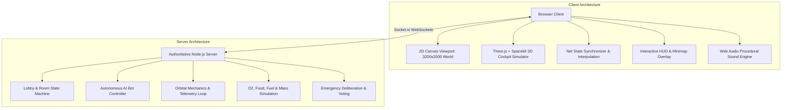

# Road to Mars (2026 NASA Space Apps Challenge)

> **Space Mission Design Game and Multiplayer Survival Simulation**  
> *A hybrid 2D top-down spaceship management and real-time 3D orbital space flight simulator.*

[](https://nodejs.org/)
[](https://socket.io/)
[](https://threejs.org/)
[](https://typpo.github.io/spacekit/)
[](https://www.spaceappschallenge.org/)

---

## Table of Contents
1. [Project Overview](#project-overview)
2. [Core Game Architecture](#core-game-architecture)
3. [The Two Perspectives](#the-two-perspectives)
   - [Inside the Spacecraft (2D Top-Down Simulation)](#1-inside-the-spacecraft-2d-top-down-simulation)
   - [At the Pilot Console (3D Space Flight Simulator)](#2-at-the-pilot-console-3d-space-flight-simulator)
4. [The Lunar Detour and Trade-off Mechanics](#the-lunar-detour-and-trade-off-mechanics)
5. [The 10 Ship Compartments](#the-10-ship-compartments)
6. [Interactive Controls and Keybindings](#interactive-controls-and-keybindings)
7. [Quick Start & System Requirements (Must Have Node.js)](#quick-start--system-requirements-must-have-nodejs)
8. [Module and File Structure](#module-and-file-structure)
9. [Telemetry, Networking and Protocols](#telemetry-networking-and-protocols)
10. [Credits and References](#credits-and-references)

---

## Project Overview

**"Road to Mars"** is an authoritative browser-based multiplayer survival and space mission design game built for the **2026 NASA Space Apps Challenge**. 

Designed for **1 to 6 crewmates** (human players joined over WebSockets, with autonomous AI Bots seamlessly filling empty slots), players work together to maintain a spacecraft en route from Earth to Mars. The crew must balance finite resources: **Delta-V ($\Delta v$) Fuel**, **Oxygen ($O_2$)**, **Food Supplies**, **Ship Mass ($kg$)**, and **Hull Integrity**. 

When engineering failures, asteroid impacts, or critical supply shortages strike, the crew must call **Emergency Meetings** to debate, vote, and—if necessary—eject mass or crewmates through the airlock to ensure the survival of the mission.

---

## Core Game Architecture



The game is structured as an authoritative server architecture with zero client-side trust for game state:
- **Authoritative Node.js / Express 5 backend**: Runs high-rate physics and resource simulation loops, calculates orbital transfer burns, checks collision geometry, manages AI crewmates, and handles voting outcomes.
- **Client-side HTML5 Canvas 2D engine**: Renders an authentic top-down cartoon aesthetic with dynamic camera damping, Y-sort depth ordering, raycasted line-of-sight visibility, and interactive mini-tasks.
- **Three.js + Spacekit.js 3D Flight Simulator**: Renders real-time 3D celestial bodies (Sun, Earth, Moon, Mars), procedural asteroid fields, and high-detail GLTF spacecraft models.

---

## The Two Perspectives

### 1. Inside the Spacecraft (2D Top-Down Simulation)
Inside the ship, players control authentic crewmate beans walking through a massive **3200x2000** interconnected spaceship hull inspired by *The Skeld*:
- **Proximity-Based Task Consoles**: Approach consoles to perform mission-critical engineering tasks (O2 scrubber calibration, reactor alignment, circuit breaker rewiring, communications dish targeting).
- **Physical Collision & Y-Sort**: Crewmates, consoles, tables, and machinery are dynamically Y-sorted so characters naturally walk behind or in front of ship equipment.
- **Close Follow Camera (`1.35x` zoom)**: The viewport tracks your crewmate closely, revealing corridors and rooms organically as you navigate the ship.
- **Minimap Overlay (`M` key)**: Displays a full architectural blueprint of all 10 compartments, task alerts (`!`), and live crewmate positioning.

### 2. At the Pilot Console (3D Space Flight Simulator)
Any crewmate who walks into the Navigation Room can press **`PILOT 3D`** (or hotkey **`P`**) to claim the pilot seat and transition seamlessly into a full **3D Space Flight & Orbital Cockpit Simulator**:
- **Real 3D GLTF Spacecraft**: Renders the spacecraft (`craft_cargoA.glb`) with animated glowing engine thruster plumes.
- **Dual Camera Flight Modes (`C` key)**:
  - **3rd-Person Chase Cam**: Trailing camera with smooth positional lag, dynamic banking, and pitch roll response during flight maneuvers.
  - **1st-Person Cockpit POV**: Inside-the-windshield view featuring holographic HUD reticles, target lock boxes on Mars and the Moon, and real-time distance/speed readouts.
- **Active 3D Flight Controls**:
  - `W` / `S`: Throttle adjustments and pitch trim.
  - `A` / `D`: Yaw and bank steering.
  - `SPACE` / `SHIFT`: Afterburner boost with intense particle plumes.
  - `L`: 5-second automated lunar descent maneuver.
  - `ESC`: Instantly release the pilot controls and return to walking in 2D.

---

## The Lunar Detour and Trade-off Mechanics

```
                 Direct Hohmann Path (Low Fuel, High Starvation Risk)
       Earth --------------------------------------------------------> Mars
         \                                                            ^
          \-- [Moon Detour] -----------------------------------------/
              - Extra Mission Time (+30 Days)
              - Extra Fuel Burn (Δv: -850 m/s)
              - Heavy Oxygen Consumption (O2: -25%)
              + Harvest Lunar Romy Cheese (Food: +100%)
              + Collect Lunar Scientific Samples (+500 Science Points)
              - Adds Significant Cargo Mass (kg)
```

The pilot faces a critical strategic decision: **Stay on the direct Hohmann transfer** to Mars, or **steer toward the Moon for a lunar landing detour**:
1. **The Risk**: Departing for the Moon expends massive $\Delta v$, burns additional Oxygen, and extends mission flight time.
2. **The Reward**: Landing on the Moon allows crewmates to disembark onto the 2D Lunar surface to harvest high-calorie **Lunar Romy Cheese** and collect valuable Moon Rocks.
3. **The Penalty**: Collecting cheese and rocks adds raw **Mass ($kg$)** to the ship. A heavier ship requires significantly more $\Delta v$ for the final Mars orbital capture burn, forcing the crew to reconsider what cargo—or who—stays onboard!

---

## The 10 Ship Compartments

The ship layout spans **`3200 x 2000`** coordinate units with fully modeled bulkheads, metallic gratings, and room-specific machinery:

| # | Room | Coordinates $(X, Y)$ | Primary Function & Consoles |
|---|------|---------------------|-----------------------------|
| 1 | **Cafeteria** | `(1400, 800)` | Primary spawn point, Central Emergency Meeting Table, Food Ration Dispenser. |
| 2 | **Navigation / Cockpit** | `(2750, 950)` | Pilot Console (triggers 3D Flight Simulator), Orbital Trajectory Plotter. |
| 3 | **O2 & Hydroponics** | `(2250, 450)` | CO2 Scrubbing System, Hydroponic Greenhouse, Oxygen Canister Pressure Valves. |
| 4 | **Weapons & Shielding** | `(2350, 1450)` | Meteor Deflection Laser Console, Radiation Shield Calibrator. |
| 5 | **Storage & Cargo Airlock**| `(1500, 1450)` | Cargo Mass Scale, Emergency Ejection Airlock chute. |
| 6 | **Electrical Grid** | `(850, 1350)` | Power Distribution Grid, Wire Repair Panels, Circuit Breakers. |
| 7 | **Science & MedBay** | `(850, 450)` | Lunar Romy Cheese Quality Scanner, Lunar Rock Mass Spectrometer. |
| 8 | **Upper Reactor** | `(300, 600)` | Sub-light Fusion Reactor, Plasma Injector Manifold. |
| 9 | **Lower Reactor** | `(300, 1300)` | Thermal Coolant Regulation, Main Thruster Fuel Feed. |
| 10 | **Security & Comms** | `(600, 950)` | Deep Space Communications Array, Long-Range Telemetry Monitor. |

---

## Interactive Controls and Keybindings

### 2D Ship Interior Controls
- **`W`, `A`, `S`, `D` / Arrow Keys**: Move crewmate.
- **`E` / Space / `USE` Button**: Interact with nearby task console, food dispenser, or pilot chair.
- **`P` / `PILOT 3D` Button**: Instantly claim the pilot console and launch the 3D Flight Simulator.
- **`M` / `MAP` Button**: Toggle the Ship Blueprint Minimap overlay.
- **`R` / `REPORT` Button**: Report a body or trigger a crisis notification.
- **`EMERGENCY`**: Call an Emergency Meeting at the Cafeteria table.

### 3D Cockpit Flight Controls
- **`W` / `S`**: Adjust engine throttle (`0%` to `100%`) and pitch control.
- **`A` / `D`**: Yaw and bank steering (`-180°` to `+180°`).
- **`SPACE` / `SHIFT`**: Fire afterburner thrusters (boosts acceleration with particle plumes).
- **`C`**: Toggle Camera: **3rd-Person Chase Cam** ⇄ **1st-Person Cockpit POV**.
- **`L` / `LAND ON MOON`**: Execute 5-second lunar landing sequence.
- **`ESC` / `LEAVE CONTROLS`**: Release pilot seat and return to the 2D interior.

---

## System Requirements and Local Installation

### Mandatory Requirement: Node.js (Must Have)

**Node.js is strictly mandatory to run Road to Mars.** 
The entire game engine is built on an authoritative Node.js and Socket.io architecture. Node.js powers:
- The WebSocket server synchronizing multiplayer movement, physics, and actions.
- The life-support simulation ticks (Oxygen, Fuel, Mass, Starvation, and Hull integrity).
- Autonomous AI crewmate behavior and pathfinding.
- Emergency meeting voting tallies and airlock ejection cutscenes.
- Serving all 2D canvas assets, Three.js 3D GLTF models, and procedural audio.

Without Node.js installed on your machine, the game server cannot boot.

#### Required Version
- **Minimum**: Node.js `v18.0.0`
- **Recommended**: Node.js `v20.x` LTS or `v22.x` LTS
- **Package Manager**: npm `v9.0.0+` (automatically included when installing Node.js)

---

### How to Download and Install Node.js

Choose the installation option appropriate for your operating system:

#### Option 1: Official Graphical Installer (Recommended for Beginners - Windows and macOS)
1. Go to the official Node.js website: [https://nodejs.org/](https://nodejs.org/)
2. On the home page, select the version labeled **LTS (Long Term Support)**, such as `v20.x` or `v22.x`.
3. Download and run the installer:
   - **Windows (`.msi`)**: Run the setup wizard. Accept the license agreement, choose your installation path, and make sure the option **"Add to PATH"** is enabled. Complete the installation.
   - **macOS (`.pkg`)**: Open the downloaded package and follow the on-screen installer prompts.
4. Close and reopen your terminal, PowerShell, or command prompt to refresh system environment variables.

#### Option 2: Command-Line Package Managers (Windows, macOS, Linux)

- **Windows (PowerShell as Administrator via winget)**:
  ```powershell
  winget install OpenJS.NodeJS.LTS
  ```
  Or via Chocolatey:
  ```powershell
  choco install nodejs-lts
  ```

- **macOS (via Homebrew)**:
  ```bash
  brew install node
  ```

- **Linux (Ubuntu / Debian / Linux Mint via NodeSource)**:
  ```bash
  # Download and configure the NodeSource PPA for Node.js 22.x
  curl -fsSL https://deb.nodesource.com/setup_22.x | sudo -E bash -
  
  # Install Node.js and npm
  sudo apt-get install -y nodejs
  ```

- **Linux (Fedora / RHEL / CentOS via DNF)**:
  ```bash
  sudo dnf install -y nodejs npm
  ```

- **Linux (Arch Linux / Manjaro via Pacman)**:
  ```bash
  sudo pacman -S nodejs npm
  ```

#### Option 3: Node Version Manager (Recommended for Advanced Users)
Node Version Manager (`nvm` on Linux/macOS or `nvm-windows` on Windows) allows you to install and switch between multiple Node.js versions without root conflicts:

- **Linux and macOS (`nvm`)**:
  ```bash
  # 1. Install nvm
  curl -o- https://raw.githubusercontent.com/nvm-sh/nvm/v0.39.7/install.sh | bash
  
  # 2. Reload shell configuration
  source ~/.bashrc   # or source ~/.zshrc on macOS
  
  # 3. Install and activate Node.js 22 LTS
  nvm install 22
  nvm use 22
  ```

- **Windows (`nvm-windows`)**:
  1. Download `nvm-setup.exe` from the official repository: [https://github.com/coreybutler/nvm-windows/releases](https://github.com/coreybutler/nvm-windows/releases)
  2. Run the installer and open a new PowerShell window.
  3. Install and activate Node.js:
     ```powershell
     nvm install 22
     nvm use 22
     ```

#### Verify Your Node.js and NPM Installation
After installation, open your terminal or command prompt and run:
```bash
node -v
npm -v
```
Both commands must output their installed version numbers without errors:
- Expected `node -v` output: `v18.x.x`, `v20.x.x`, or `v22.x.x`
- Expected `npm -v` output: `9.x.x` or `10.x.x`

If both commands return version numbers, Node.js is ready and you can proceed with local installation.

---

### Hardware and Operating System Prerequisites

Ensure your host environment meets the following hardware and software requirements:

1. **Hardware Specifications**:
   - **Processor**: 64-bit dual-core CPU (Intel Core i3 / AMD Ryzen 3 / Apple Silicon M-series or equivalent).
   - **Memory**: Minimum 2 GB RAM (4 GB or more recommended for smooth 3D rendering and multiple local clients).
   - **Graphics**: Integrated or dedicated GPU supporting **WebGL 2.0** and hardware-accelerated canvas rendering.

2. **Operating System**:
   - **Linux**: Ubuntu 20.04+, Debian 11+, Fedora 38+, Arch Linux, or any modern distribution.
   - **macOS**: macOS 11.0 (Big Sur) or newer.
   - **Windows**: Windows 10 or Windows 11 (native PowerShell, Command Prompt, or WSL2).

3. **Software & Runtime Dependencies**:
   - **Git**: Required to clone and manage project source code.  
     Verify with:
     ```bash
     git --version
     ```
   - **Web Browser**: A modern browser with WebGL 2.0 and WebSocket support enabled:
     - Google Chrome (version 100+)
     - Brave Browser
     - Mozilla Firefox (version 100+)
     - Microsoft Edge
     - Apple Safari (version 15+)

4. **Network & Port Availability**:
   - By default, the server binds to port `3000`. Ensure port `3000` is open and not blocked by local firewalls (e.g. `ufw`, `iptables`, or Windows Defender Firewall).

---

### Step-by-Step Installation

1. **Clone the Repository**:
   Clone the repository from your source host:
   ```bash
   git clone <repository_url>
   cd "Game play/Road to Mars"
   ```

2. **Inspect Directory Contents**:
   Confirm that `server.js`, `package.json`, and the `public/` folder are present:
   ```bash
   ls -la
   ```

3. **Install Node.js Dependencies**:
   Install the required server packages (`express`, `socket.io`, `cors`):
   ```bash
   npm install
   ```

4. **Verify Asset Linkage**:
   The game engine serves 3D GLTF models (`craft_cargoA.glb`, `rock_largeA.glb`, `satelliteDish_detailed.glb`), planet textures, and isometric room sprites from the shared `assets` directory. Ensure the `../assets` folder exists or is mounted by the server:
   ```bash
   ls -la ../assets/kenney_space-kit/Models/GLTF\ format/
   ```

---

## How to Boot the Game

### Server Boot Options

You can boot the game server using any of the following modes depending on your workflow:

#### Option A: Standard Production Boot (Recommended)
Runs the authoritative WebSocket game server on default port `3000`:
```bash
npm start
```
Or run directly with Node:
```bash
node server.js
```
The terminal will display:
```
Road to Mars server listening on port 3000
```

#### Option B: Development Mode (Auto-Reload on Code Edit)
Runs Node with native file watching. Any modification to `server.js` or client assets will automatically reboot the server without manual restarts:
```bash
npm run dev
```

#### Option C: Booting on a Custom Port
If port `3000` is already in use by another application, specify an alternate port via the `PORT` environment variable:
```bash
PORT=8080 npm start
```
Then navigate to `http://localhost:8080` in your browser.

#### Option D: Running in the Background (Daemon Mode on Linux / macOS)
To keep the server running continuously in the background after closing the terminal:
```bash
nohup node server.js > server.log 2>&1 &
```
To check if the daemon is running:
```bash
ps aux | grep "node server.js"
```
To stop the background server:
```bash
fuser -k 3000/tcp
```

---

### Launching Clients (Solo Bots vs LAN Multiplayer)

Once the server is booted, clients can join locally or over a local area network (LAN):

#### 1. Single-Player Boot (with Autonomous AI Bots)
1. Open your browser and navigate to:
   ```
   http://localhost:3000
   ```
2. Enter your **Crewmate Name** and select your preferred **Suit Color**.
3. Click **Create Room** (or join an existing room code).
4. Click **Start Game**.
5. The authoritative server automatically initializes and boots autonomous **AI Bots** to fill all remaining slots up to the 6-player roster. The bots will navigate the ship, execute life-support tasks, vote during emergency meetings, and roam alongside you.

#### 2. Local LAN Multiplayer Boot (Play with Friends on the Same Network)
1. Determine the host machine's local IP address:
   - **Linux / macOS**:
     ```bash
     ip addr show | grep "inet " || ifconfig | grep "inet "
     ```
   - **Windows (PowerShell)**:
     ```powershell
     ipconfig
     ```
     *(Look for your IPv4 Address, for example: `192.168.1.150`)*
2. On any other computer, laptop, tablet, or smartphone connected to the same Wi-Fi/LAN router, open the browser and navigate to:
   ```
   http://<HOST_IP_ADDRESS>:3000
   ```
   *(Example: `http://192.168.1.150:3000`)*
3. Players enter their names, select distinct colors, and enter the Host's Room Code to join the mission.

#### 3. Multi-Client Testing on a Single Machine
To test multiplayer interactions, synchronization, and the 3D pilot seat lock on one computer:
- Open `http://localhost:3000` in your primary browser window.
- Open a second instance in an **Incognito / Private Window** or a secondary browser (e.g. Brave and Chrome side-by-side).
- Connect both windows to the same room. You will see real-time player position interpolation, chat, task progress, and pilot transitions synchronized across both windows.

---

### Troubleshooting Common Boot Issues

- **Port Conflict (`Error: listen EADDRINUSE: address already in use :::3000`)**:  
  Another service is occupying port 3000. Terminate the blocking process:
  - On Linux / macOS:
    ```bash
    fuser -k 3000/tcp
    # Or find and kill manually:
    lsof -i :3000
    kill -9 <PID>
    ```
  - On Windows (PowerShell as Administrator):
    ```powershell
    Stop-Process -Id (Get-NetTCPConnection -LocalPort 3000).OwningProcess -Force
    ```

- **Missing Node Modules (`Error: Cannot find module 'express'`)**:  
  Run `npm install` inside the `Road to Mars` folder to ensure all dependencies are downloaded.

- **WebGL 2.0 Disabled or Black 3D Cockpit Screen**:  
  Make sure your browser has hardware acceleration enabled:
  - Chrome / Brave / Edge: Navigate to `chrome://settings/system` and ensure **"Use graphics acceleration when available"** is checked.
  - Verify WebGL support by visiting `https://get.webgl.org/webgl2/`.

---

## Module and File Structure

```
Road to Mars/
├── NASA_ASSETS_CATALOG.md    # Complete catalog of all NASA 3D models and photos
├── package.json              # Project dependencies (Express 5, Socket.io 4.8, CORS)
├── server.js                 # Authoritative Node.js simulation & WebSocket server
├── public/
│   ├── index.html            # Main HTML5 entry point & canvas mounts
│   ├── favicon.png           # Crewmate astronaut icon
│   ├── nasa-models/          # Authentic NASA 3D STL/GLB models & high-res space photos
│   │   ├── Asteroid 101955 Bennu.stl
│   │   ├── Asteroid 4179 Toutatis.stl
│   │   ├── Asteroid 1620 Geographos.stl
│   │   ├── Asteroid 216 Kleopatra.stl
│   │   ├── Asteroid 25143 Itokawa.stl
│   │   ├── Block Island.stl
│   │   ├── Apollo 14 - Landing Site.stl
│   │   ├── Curiosity Landing Site.stl
│   │   ├── Astronaut.glb
│   │   ├── Extravehicular Mobility Unit.glb
│   │   ├── Advanced Crew Escape Suit.glb
│   │   ├── Z2 Spacesuit.glb
│   │   ├── Apollo 11 - View of the Moon.jpg
│   │   └── Earth (B).jpg
│   ├── assets/               # Bundled Kenney 3D GLTF models, planet textures, sprites & audio
│   ├── css/
│   │   └── style.css         # Retro sci-fi HUD, minimap, meeting & archive viewer UI styles
│   ├── js/
│   │   ├── main.js           # Client orchestration & lifecycle coordinator
│   │   ├── net.js            # Socket.io networking, client lerping & packet dispatcher
│   │   ├── renderer.js       # 2D top-down canvas engine, minimap & sprite renderer
│   │   ├── cockpit.js        # Three.js 3D space flight simulator & orbital viewer
│   │   ├── hud.js            # HUD status bars, action buttons & pilot triggers
│   │   ├── ship.js           # 2D player state, proximity interaction & collision logic
│   │   ├── moon.js           # Lunar detour surface exploration & cheese harvesting
│   │   ├── tasks.js          # Interactive engineering mini-game canvas dialogs
│   │   ├── meeting.js        # Emergency meeting voting UI & airlock ejection cutscene
│   │   ├── lobby.js          # Room creation, player color picker & lobby screen
│   │   ├── audio.js          # Web Audio API procedural sound synthesizer
│   │   ├── nasa-archive.js   # Interactive 3D model & photograph archive viewer
│   │   └── debrief.js        # Mission outcome summary & NASA scoring report
```

---

## Telemetry, Networking and Protocols

### Key Socket.io Events
- `player:register` / `player:registered`: Authenticates client and assigns initial spawn coordinate.
- `room:create` / `room:join`: Manages lobby formation and peer sync.
- `game:start`: Transitions room to active mission, spawns bots, and starts orbital tick.
- `player:move`: High-frequency client-predicted coordinate broadcast with authoritative server bounds validation.
- `pilot:seat:claim` / `pilot:seat:locked` / `pilot:seat:release`: Authoritative lock ensuring only one pilot controls the 3D ship at any time.
- `moon:land` / `moon:surface:enter`: Synchronizes the lunar landing sequence across all crewmates.
- `resource:update`: Authoritative broadcast of $O_2$, Fuel, Food, Mass, and Hull values.
- `meeting:start` / `meeting:vote` / `meeting:ended`: Deliberation protocol and airlock ejection vote tallying.

---

## Credits and References

- **NASA Space Apps Challenge 2026**: Space Mission Design Game category.
- **Three.js**: 3D WebGL rendering engine.
- **Spacekit.js**: Accurate Keplerian orbital trajectory calculations.
- **Kenney.nl**: Space-Kit 3D GLTF models, Planet textures, and Isometric 2D sprite kits.
- **Innersloth**: Inspiration from *Among Us* for social deduction and spacecraft survival mechanics.

---
*Built for the 2026 NASA Space Apps Challenge.*
