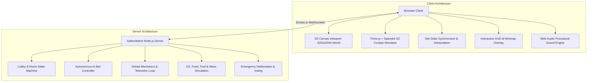

# Road to Mars (2026 NASA Space Apps Challenge)

> **Space Mission Design Game and Multiplayer Survival Simulation**  
> *A hybrid 2D top-down spaceship management and real-time 3D orbital space flight simulator.*

[](https://nodejs.org/)
[](https://socket.io/)
[](https://threejs.org/)
[](https://typpo.github.io/spacekit/)
[](https://www.spaceappschallenge.org/)

---

## Table of Contents
1. [Project Overview](#project-overview)
2. [Core Game Architecture](#core-game-architecture)
3. [The Two Perspectives](#the-two-perspectives)
   - [Inside the Spacecraft (2D Top-Down Simulation)](#1-inside-the-spacecraft-2d-top-down-simulation)
   - [At the Pilot Console (3D Space Flight Simulator)](#2-at-the-pilot-console-3d-space-flight-simulator)
4. [The Lunar Detour and Trade-off Mechanics](#the-lunar-detour-and-trade-off-mechanics)
5. [The 10 Ship Compartments](#the-10-ship-compartments)
6. [Interactive Controls and Keybindings](#interactive-controls-and-keybindings)
7. [Quick Start & System Requirements (Must Have Node.js)](#quick-start--system-requirements-must-have-nodejs)
8. [Module and File Structure](#module-and-file-structure)
9. [Telemetry, Networking and Protocols](#telemetry-networking-and-protocols)
10. [Credits and References](#credits-and-references)

---

## Project Overview

**"Road to Mars"** is an authoritative browser-based multiplayer survival and space mission design game built for the **2026 NASA Space Apps Challenge**. 

Designed for **1 to 6 crewmates** (playable solo or with up to 6 players joined over local network WebSockets), players work together to maintain a spacecraft en route from Earth to Mars. The crew must balance finite resources: **Delta-V ($\Delta v$) Fuel**, **Oxygen ($O_2$)**, **Clean Water Reserve ($H_2O$)**, **Carbon Dioxide ($CO_2$)**, **Food Supplies**, **Ship Mass ($kg$)**, and **Hull Integrity**. Reaching Mars triggers **Endless Free-Play Mode** for continued orbital exploration. 

When engineering failures, asteroid impacts, or critical supply shortages strike, the crew must call **Emergency Meetings** to debate, vote, and—if necessary—eject mass or crewmates through the airlock to ensure the survival of the mission.

---

## Core Game Architecture



The game is structured as an authoritative server architecture with zero client-side trust for game state:
- **Authoritative Node.js / Express 5 backend**: Runs high-rate physics and resource simulation loops, calculates orbital transfer burns, checks collision geometry, manages AI crewmates, and handles voting outcomes.
- **Client-side HTML5 Canvas 2D engine**: Renders an authentic top-down cartoon aesthetic with dynamic camera damping, Y-sort depth ordering, raycasted line-of-sight visibility, and interactive mini-tasks.
- **Three.js + Spacekit.js 3D Flight Simulator**: Renders real-time 3D celestial bodies (Sun, Earth, Moon, Mars), procedural asteroid fields, and high-detail GLTF spacecraft models.

---

## The Two Perspectives

### 1. Inside the Spacecraft (2D Top-Down Simulation)
Inside the ship, players control authentic crewmate beans walking through a massive **3200x2000** interconnected spaceship hull inspired by *The Skeld*:
- **13 Proximity-Based Interactive Task Consoles**: Approach consoles to complete full interactive Canvas mini-games:
  1. `wires`: Wire repair and circuit routing.
  2. `o2_filter`: Hydroponic vegetable farm (potatoes, lettuce, tomatoes) & O2 production.
  3. `water_recycle`: ECLSS 3-stage water filtration and clean H2O pumping.
  4. `co2_scrubber`: Zeolite canister CO2 purging and O2 partial pressure regulation.
  5. `nav`: Radar alignment and 3-axis IMU gyro calibration.
  6. `cargo`: Hull plate welding and cargo stabilization.
  7. `science`: Deep space satellite telemetry alignment.
  8. `cheese_grill`: Zero-G Romy cheese melter and sandwich press.
  9. `reactor_cool`: Boron cryo control rods & coolant regulation.
  10. `shields_prime`: Hexagonal deflector shield capacitor charging.
  11. `fuel_synth`: Sabatier fuel synthesis & propellant pump.
  12. `engine_align`: Thruster gimbal alignment with Mars trajectory.
  13. `medbay_scan`: Full bio-radiation crewmate health scanner.
- **Physical Collision & Y-Sort**: Crewmates, consoles, tables, and machinery are dynamically Y-sorted so characters naturally walk behind or in front of ship equipment.
- **Close Follow Camera (`1.35x` zoom)**: The viewport tracks your crewmate closely, revealing corridors and rooms organically as you navigate the ship.
- **Minimap Overlay (`M` key)**: Displays a full architectural blueprint of all 10 compartments, task alerts (`!`), and live crewmate positioning.

### 2. At the Pilot Console (3D Space Flight Simulator)
Any crewmate who walks into the Navigation Room can press **`PILOT 3D`** (or hotkey **`P`**) to claim the pilot seat and transition seamlessly into a full **3D Space Flight & Orbital Cockpit Simulator**:
- **Real 3D GLTF Spacecraft**: Renders high-speed interceptor spacecraft with metallic PBR standard materials (`metalness: 0.82`, `roughness: 0.24`) and animated glowing engine thruster plumes.
- **Compact Aerospace Flight Deck**: Ultra-compact sci-fi HUD deck (~72px) with live micro vital bars (Hull, Fuel, O2), attitude readout (`HDG`, `Pitch`, `Roll`), dedicated 90×90px 3-Axis IMU Gyro HUD, and minimize toggle `[▾/▴]`.
- **Dual Camera Flight Modes (`C` key)**:
  - **3rd-Person Chase Cam**: Trailing camera with smooth positional lag, dynamic banking, and pitch roll response during flight maneuvers.
  - **1st-Person Cockpit POV**: Inside-the-windshield view featuring holographic HUD reticles, target lock boxes on Mars and the Moon, and real-time distance/speed readouts.
- **Active 3D Flight Controls**:
  - `W` / `S`: Throttle adjustments and pitch trim.
  - `A` / `D`: Yaw and bank steering.
  - `SPACE` / `SHIFT`: Afterburner boost with intense particle plumes.
  - `L`: 5-second automated lunar descent maneuver.
  - `ESC`: Instantly release the pilot controls and return to walking in 2D.

---

## The Lunar Detour and Trade-off Mechanics

```
                 Direct Hohmann Path (Low Fuel, High Starvation Risk)
       Earth --------------------------------------------------------> Mars
         \                                                            ^
          \-- [Moon Detour] -----------------------------------------/
              - Extra Mission Time (+30 Days)
              - Extra Fuel Burn (Δv: -850 m/s)
              - Heavy Oxygen Consumption (O2: -25%)
              + Harvest Lunar Romy Cheese (Food: +100%)
              + Collect Lunar Scientific Samples (+500 Science Points)
              - Adds Significant Cargo Mass (kg)
```

The pilot faces a critical strategic decision: **Stay on the direct Hohmann transfer** to Mars, or **steer toward the Moon for a lunar landing detour**:
1. **The Risk**: Departing for the Moon expends massive $\Delta v$, burns additional Oxygen, and extends mission flight time.
2. **The Reward**: Landing on the Moon allows crewmates to disembark onto the 2D Lunar surface to harvest high-calorie **Lunar Romy Cheese** and collect valuable Moon Rocks.
3. **The Penalty**: Collecting cheese and rocks adds raw **Mass ($kg$)** to the ship. A heavier ship requires significantly more $\Delta v$ for the final Mars orbital capture burn, forcing the crew to reconsider what cargo—or who—stays onboard!

---

## The 10 Ship Compartments

The ship layout spans **`3200 x 2000`** coordinate units with fully modeled bulkheads, metallic gratings, and room-specific machinery:

| # | Room | Coordinates $(X, Y)$ | Primary Function & Consoles |
|---|------|---------------------|-----------------------------|
| 1 | **Cafeteria** | `(1400, 800)` | Primary spawn point, Central Emergency Meeting Table, Food Ration Dispenser. |
| 2 | **Navigation / Cockpit** | `(2750, 950)` | Pilot Console (triggers 3D Flight Simulator), Orbital Trajectory Plotter. |
| 3 | **O2 & Hydroponics** | `(2250, 450)` | CO2 Scrubbing System, Hydroponic Greenhouse, Oxygen Canister Pressure Valves. |
| 4 | **Weapons & Shielding** | `(2350, 1450)` | Meteor Deflection Laser Console, Radiation Shield Calibrator. |
| 5 | **Storage & Cargo Airlock**| `(1500, 1450)` | Cargo Mass Scale, Emergency Ejection Airlock chute. |
| 6 | **Electrical Grid** | `(850, 1350)` | Power Distribution Grid, Wire Repair Panels, Circuit Breakers. |
| 7 | **Science & MedBay** | `(850, 450)` | Lunar Romy Cheese Quality Scanner, Lunar Rock Mass Spectrometer. |
| 8 | **Upper Reactor** | `(300, 600)` | Sub-light Fusion Reactor, Plasma Injector Manifold. |
| 9 | **Lower Reactor** | `(300, 1300)` | Thermal Coolant Regulation, Main Thruster Fuel Feed. |
| 10 | **Security & Comms** | `(600, 950)` | Deep Space Communications Array, Long-Range Telemetry Monitor. |

---

## Interactive Controls and Keybindings

### 2D Ship Interior Controls
- **`W`, `A`, `S`, `D` / Arrow Keys**: Move crewmate.
- **`E` / Space / `USE` Button**: Interact with nearby task console, food dispenser, or pilot chair.
- **`P` / `PILOT 3D` Button**: Instantly claim the pilot console and launch the 3D Flight Simulator.
- **`M` / `MAP` Button**: Toggle the Ship Blueprint Minimap overlay.
- **`R` / `REPORT` Button**: Report a body or trigger a crisis notification.
- **`EMERGENCY`**: Call an Emergency Meeting at the Cafeteria table.

### 3D Cockpit Flight Controls
- **`W` / `S`**: Adjust engine throttle (`0%` to `100%`) and pitch control.
- **`A` / `D`**: Yaw and bank steering (`-180°` to `+180°`).
- **`SPACE` / `SHIFT`**: Fire afterburner thrusters (boosts acceleration with particle plumes).
- **`C`**: Toggle Camera: **3rd-Person Chase Cam** ⇄ **1st-Person Cockpit POV**.
- **`L` / `LAND ON MOON`**: Execute 5-second lunar landing sequence.
- **`ESC` / `LEAVE CONTROLS`**: Release pilot seat and return to the 2D interior.

---

## Quick Start & System Requirements (Must Have Node.js)

### Node.js is Strictly Required
You must have Node.js (version 18 or newer) installed to run Road to Mars. 
Without Node.js, the local game server and WebSocket multiplayer cannot boot.

### 1-Command Node.js Installation (Fastest Way)

- **Windows** (PowerShell):
  ```powershell
  winget install OpenJS.NodeJS.LTS
  ```
  *(Or download the LTS installer from https://nodejs.org/)*

- **macOS** (Terminal):
  ```bash
  brew install node
  ```
  *(Or download the macOS installer from https://nodejs.org/)*

- **Linux** (Terminal):
  ```bash
  # Ubuntu / Debian
  sudo apt update && sudo apt install -y nodejs npm

  # Fedora / RHEL
  sudo dnf install -y nodejs npm

  # Arch Linux
  sudo pacman -S nodejs npm
  ```

#### Verify Node.js
In your terminal, run:
```bash
node -v
npm -v
```

---

### How to Boot the Game in 2 Commands

Open your terminal in the `Road to Mars` directory:

```bash
# 1. Install dependencies (first time only)
npm install

# 2. Start the game server
npm start
```

Then open your browser to:
```
http://localhost:3000
```

- **Solo Mode**: Click **Create Room** -> **Launch Expedition** (1 player can launch immediately).
- **Same Wi-Fi / LAN Multiplayer**: The game automatically detects your local Wi-Fi IP address (e.g. `http://192.168.1.14:3000`). Click **🔗 LINK** inside the hangar or copy the displayed invite link (`http://192.168.1.14:3000/?room=CODE`) to join instantly from other PCs or phones on the network.
- **Internet Multiplayer**: Run `npx localtunnel --port 3000` to share a public HTTPS link with friends outside your network.
- **Custom Port**: Run with `PORT=8080 npm start`.

---

## Module and File Structure

```
Road to Mars/
├── NASA_ASSETS_CATALOG.md    # Complete catalog of all NASA 3D models and photos
├── package.json              # Project dependencies (Express 5, Socket.io 4.8, CORS)
├── server.js                 # Authoritative Node.js simulation & WebSocket server
├── public/
│   ├── index.html            # Main HTML5 entry point & canvas mounts
│   ├── favicon.png           # Crewmate astronaut icon
│   ├── nasa-models/          # Authentic NASA 3D STL/GLB models & high-res space photos
│   │   ├── Asteroid 101955 Bennu.stl
│   │   ├── Asteroid 4179 Toutatis.stl
│   │   ├── Asteroid 1620 Geographos.stl
│   │   ├── Asteroid 216 Kleopatra.stl
│   │   ├── Asteroid 25143 Itokawa.stl
│   │   ├── Block Island.stl
│   │   ├── Apollo 14 - Landing Site.stl
│   │   ├── Curiosity Landing Site.stl
│   │   ├── Astronaut.glb
│   │   ├── Extravehicular Mobility Unit.glb
│   │   ├── Advanced Crew Escape Suit.glb
│   │   ├── Z2 Spacesuit.glb
│   │   ├── Apollo 11 - View of the Moon.jpg
│   │   └── Earth (B).jpg
│   ├── assets/               # Bundled Kenney 3D GLTF models, planet textures, sprites & audio
│   ├── css/
│   │   └── style.css         # Retro sci-fi HUD, minimap, meeting & archive viewer UI styles
│   ├── js/
│   │   ├── main.js           # Client orchestration & lifecycle coordinator
│   │   ├── net.js            # Socket.io networking, client lerping & packet dispatcher
│   │   ├── renderer.js       # 2D top-down canvas engine, minimap & sprite renderer
│   │   ├── cockpit.js        # Three.js 3D space flight simulator & orbital viewer
│   │   ├── hud.js            # HUD status bars, action buttons & pilot triggers
│   │   ├── ship.js           # 2D player state, proximity interaction & collision logic
│   │   ├── moon.js           # Lunar detour surface exploration & cheese harvesting
│   │   ├── tasks.js          # Interactive engineering mini-game canvas dialogs
│   │   ├── meeting.js        # Emergency meeting voting UI & airlock ejection cutscene
│   │   ├── lobby.js          # Room creation, player color picker & lobby screen
│   │   ├── audio.js          # Web Audio API procedural sound synthesizer
│   │   ├── nasa-archive.js   # Interactive 3D model & photograph archive viewer
│   │   └── debrief.js        # Mission outcome summary & NASA scoring report
```

---

## Telemetry, Networking and Protocols

### Key Socket.io Events
- `player:register` / `player:registered`: Authenticates client and assigns initial spawn coordinate.
- `room:create` / `room:join`: Manages lobby formation and peer sync.
- `game:start`: Transitions room to active mission, spawns bots, and starts orbital tick.
- `player:move`: High-frequency client-predicted coordinate broadcast with authoritative server bounds validation.
- `pilot:seat:claim` / `pilot:seat:locked` / `pilot:seat:release`: Authoritative lock ensuring only one pilot controls the 3D ship at any time.
- `moon:land` / `moon:surface:enter`: Synchronizes the lunar landing sequence across all crewmates.
- `resource:update`: Authoritative broadcast of $O_2$, Fuel, Food, Mass, and Hull values.
- `meeting:start` / `meeting:vote` / `meeting:ended`: Deliberation protocol and airlock ejection vote tallying.

---

## Credits and References

- **NASA Space Apps Challenge 2026**: Space Mission Design Game category.
- **Three.js**: 3D WebGL rendering engine.
- **Spacekit.js**: Accurate Keplerian orbital trajectory calculations.
- **Kenney.nl**: Space-Kit 3D GLTF models, Planet textures, and Isometric 2D sprite kits.
- **Innersloth**: Inspiration from *Among Us* for social deduction and spacecraft survival mechanics.

---
*Built for the 2026 NASA Space Apps Challenge.*
